# PixelDigest

Resumo diário do trabalho em **pixel art animado**. O programa junta numa tela só tudo o que importa das empresas em que você trabalha: Slack, ClickUp, Gmail, Outlook e Teams, além do clima. Também sugere horários livres para reunião no Teams e manda os avisos para o **celular e o Discord ao mesmo tempo**.

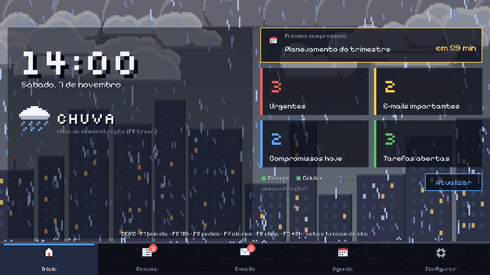

Funciona na **horizontal e na vertical**, em várias resoluções, com as informações separadas em abas (Início, Resumo do dia, E-mails e Agenda) numa barra de navegação fixa embaixo.

> **Explicação do código linha por linha:** cada arquivo do projeto tem uma página em [docs/explicacao/](docs/explicacao/README.md) com todos os trechos de código e o que cada linha faz. São 38 arquivos e 6.600 linhas, sem nenhuma linha de código de fora (o script `tools/gerar_explicacao.py` confere).

## 1. Sobre o projeto e problema resolvido

Eu trabalho em duas empresas ao mesmo tempo. Uma usa Slack, ClickUp e Gmail, a outra usa Outlook e Teams. Todo dia eu abria cinco ferramentas para descobrir o que era urgente, e mesmo assim ainda perdia mensagens. Para marcar uma reunião, era um vai e vem de "que horas você pode?".

O PixelDigest resolve isso:

* **Resumo dos e-mails com IA:** os 10 e-mails mais recentes de cada conta (ex.: trabalho e pessoal) viram os pontos importantes, com o que você precisa fazer.
* **Sem requisições repetidas:** busca tudo ao abrir; depois cada fonte só baixa de novo quando há novidade (o Gmail confere com uma chamada barata, o Slack só pega mensagens novas).
* **Às 07:00** monta o resumo do dia de todas as empresas, mostra na tela com uma animação e manda para o celular e para o Discord.
* **Ao longo do dia** avisa na hora quando aparece algo urgente: menção no Slack, tarefa atrasada no ClickUp, mensagem direta no Teams.
* **Quando alguém pede reunião no Teams**, ele entende o pedido, consulta a agenda das duas pessoas e sugere três horários livres. Também dá para digitar `reunião com Ana amanhã 45min sobre orçamento`.
* **Às 18:00** encerra o expediente e mostra o que ficou para amanhã.
* **O clima de verdade** controla o cenário: quanto mais chuva, mais escura a tela e mais fechadas as nuvens.
* **O alarme do celular** (Android) aparece na tela no momento em que toca.

Ganho prático: um lugar só para ver tudo, nenhuma menção perdida e reuniões marcadas em segundos.

## 2. Arquitetura e fluxo de funcionamento

```mermaid
flowchart LR
    subgraph Gatilhos
        A1[07:00 e 18:00]
        A2[Novidade numa fonte<br/>Gmail 2 min, Slack 10 min,<br/>ClickUp 15 min, Zoom 30 min<br/>Clima 30 min, Teams 1 min]
        A3[Alarme do celular<br/>MacroDroid → ntfy]
        A4[Comando digitado<br/>reunião com ...]
    end
    subgraph Coleta[Coleta via HTTPS / OAuth]
        B1[Slack API]
        B2[ClickUp API]
        B3[Gmail + Google Agenda]
        B4[Microsoft Graph<br/>Outlook + Teams]
        B5[Zoom API]
        B6[Open-Meteo]
    end
    subgraph Processamento
        C1[Converte JSON de cada API<br/>para o mesmo formato Item]
        C2[Prioriza: menção, atrasada,<br/>DM, importante]
        C5[Claude resume os<br/>10 e-mails de cada conta]
        C3[Reconhece pedido de reunião<br/>e busca horário livre]
        C4[Chuva → escuridão da tela]
    end
    subgraph Saídas
        D1[Tela pixel art animada]
        D2[Discord webhook]
        D3[Celular via ntfy]
        D4[data/digest-AAAA-MM-DD.json]
        D5[Reunião criada no Outlook<br/>com link do Teams]
    end
    Gatilhos --> Coleta --> Processamento --> Saídas
```

Caminho dos dados:

1. **Gatilho**: o `Motor` (`core.py`) roda em segundo plano com um agendador (`scheduler.py`). Ao abrir, faz uma busca completa; depois cada fonte é conferida no seu ritmo e só baixa de novo quando tem novidade. Também escuta o tópico do ntfy (alarme) e a fila de comandos da tela.
2. **Coleta**: cada conector (`connectors/`) chama a API da sua ferramenta pelo cliente HTTP resiliente (`net.py`) e converte o JSON para objetos `Item`.
3. **Processamento**: `digest.py` junta e ordena tudo. Se uma fonte falhar, o resumo sai mesmo assim. `resumo_email.py` manda os e-mails novos para o Claude e recebe os pontos importantes em JSON. `meetings.py` reconhece pedidos de reunião e interpreta comandos. O Microsoft Graph (`findMeetingTimes`) devolve os horários livres das duas pessoas.
4. **Saída**: a tela (`ui/`) desenha o cenário e as animações, e `notify.py` manda o mesmo aviso para Discord e celular em paralelo. Cada resumo é salvo em JSON.

A tela nunca chama APIs diretamente: ela conversa com o Motor por duas filas, uma de comandos e outra de eventos. Assim a animação não trava enquanto espera a internet.

## 3. Tecnologias e APIs utilizadas

| Camada | Tecnologia |
|---|---|
| Linguagem | Python 3.12+ |
| Interface e animações | pygame-ce (pixel art e ícones desenhados em código) com as fontes Pixelify Sans e Silkscreen (licença OFL, em `pixeldigest/ui/fontes/`) |
| HTTP | httpx (timeout, retry com backoff, tratamento de 4xx/5xx) |
| Configuração | YAML (`config.yaml`) + variáveis de ambiente (`.env`, python-dotenv) |
| Slack | Web API: `auth.test`, `users.conversations`, `conversations.history`, `conversations.info`, `users.info` (Bearer Token de usuário, paginação por cursor) |
| ClickUp | API v2: `/team/{id}/task`, `/user` (token pessoal) |
| Google | Gmail API + Calendar API (OAuth 2.0, várias contas; renovação do token por POST simples) |
| Zoom | API v2 `users/{email}/meetings` (Server-to-Server OAuth com Basic Auth) |
| IA | Claude (SDK `anthropic`, saída em JSON com schema) para o resumo dos e-mails |
| Microsoft 365 | Microsoft Graph: `calendarView`, `messages`, `chats`, `findMeetingTimes`, `events`, `people` (OAuth 2.0 device code, MSAL) |
| Clima | Open-Meteo (geocoding + forecast, sem chave) |
| Notificações | Discord Webhook (embed JSON) + ntfy (push no Android) |
| Alarme do celular | MacroDroid (Android) → ntfy → streaming JSON no PC |
| Testes | pytest + httpx.MockTransport (APIs simuladas, sem internet) |

## 4. Pré-requisitos e como executar

**Pré-requisitos:** Windows, macOS ou Linux com Python 3.12 ou mais novo.

```bash
git clone https://github.com/Numenone/PixelDigest.git
cd PixelDigest
python -m venv .venv
.venv\Scripts\activate          # no macOS/Linux: source .venv/bin/activate
pip install -r requirements.txt
```

No Windows, dá para pular esses passos: dê dois cliques em **`run.bat`**, que cria tudo sozinho.

**Testar sem nenhuma conta (modo demonstração):**

```bash
python -m pixeldigest --demo
```

Atalhos da demonstração:

| Tecla | Ação |
|---|---|
| F1 | Bom dia (07:00) |
| F2 | Fim do expediente (18:00) |
| F3 | Pedido de reunião no Teams |
| F4 | Alarme |
| F6 | Troca o clima |
| F7 | Avança 3 horas |
| F10 | Abre as Configurações |

**Usar com as suas contas: tudo pela tela de Configurações**

Não precisa editar arquivo nenhum. Na primeira vez, o programa já abre nas **Configurações**. Depois, use o botão **Configurar** (ou F10).

| Aba | O que tem |
|---|---|
| Início | seu nome, modo demonstração, abrir com o Windows, **tela** (orientação automática/horizontal/vertical, tamanho da janela, tela cheia) e fuso horário |
| Clima | busca por **endereço, bairro ou cidade** (OpenStreetMap), botão "Minha localização" e "Ver o clima agora" |
| Horários | bom dia, fim do expediente e horário de trabalho |
| Notificações | Discord (com botão Testar), celular com **QR code** para assinar no app ntfy, alarme do celular |
| Empresas | adicionar/remover/**desligar** empresas, cor de cada uma e os serviços (Slack, ClickUp, Gmail + Agenda, Zoom, Outlook + Teams) |
| Chaves de API | **todas as chaves** num lugar só: Discord, ntfy, Claude, Slack, ClickUp, Google (várias contas), Zoom e Microsoft, com botões Conectar, Fazer login e Testar |
| Reuniões | duração padrão, dias para sugerir, resposta automática no Teams e palavras de pedido |

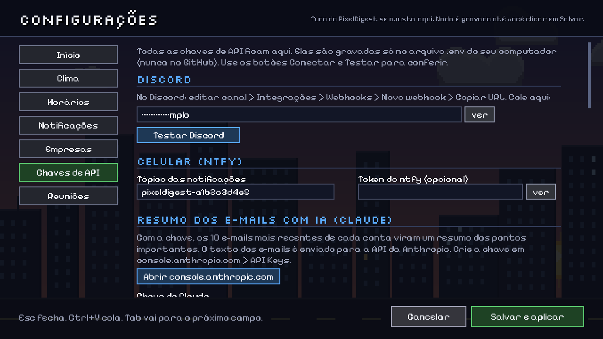

Alguns detalhes:

* **Slack:** ao clicar em Conectar, a tela lista os canais do workspace para você marcar.
* **ClickUp:** ao clicar em Conectar, a tela acha o workspace sozinha.
* **Google:** escolha o arquivo de credenciais em "Procurar..." e clique em Fazer login. O navegador abre para você autorizar.
* **Microsoft:** clique em Fazer login. A tela mostra um código grande, com os botões "Abrir site" e "Copiar código".

O passo a passo para conseguir cada chave está em [docs/conectores.md](docs/conectores.md), e o do celular em [docs/celular.md](docs/celular.md).

Outros modos (opcionais):

* `python -m pixeldigest --headless`: roda sem tela, por exemplo num servidor ou num Raspberry Pi.
* `python -m pixeldigest resumo`: gera e envia o resumo na hora.

**Rodar os testes:**

```bash
pip install -r requirements-dev.txt
python -m pytest -q
```

### Segurança das credenciais

* Nenhum token fica no código nem no `config.yaml`. A tela de Configurações grava as chaves no `.env`, e o YAML só guarda o **nome** da variável (`token_env: PD_MINHA_EMPRESA_SLACK_TOKEN`).
* Na tela, as chaves aparecem mascaradas (`••••••abcd`) e só são mostradas se você clicar em "ver".
* `.env`, `config.yaml`, `tokens/` (logins OAuth) e `data/` (resumos) estão no `.gitignore`.
* Google e Microsoft usam OAuth com permissões delegadas: o app só faz o que você mesmo poderia fazer, e o token pode ser revogado a qualquer momento.
* O modo `--demo` usa empresas fictícias, para mostrar o projeto sem expor dados reais.

## 5. Demonstração (resultados)

| | |
|---|---|
| 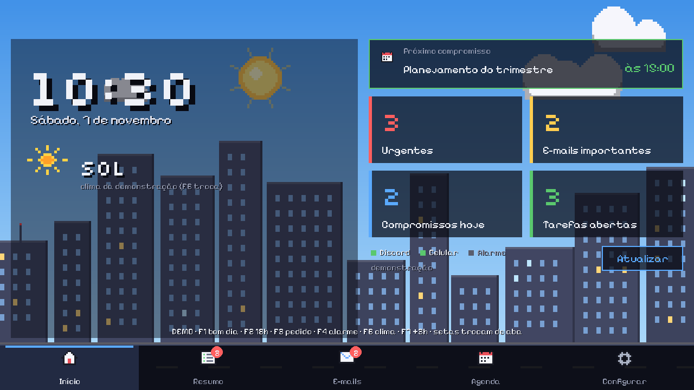 Aba Início com céu limpo |  Chuva: céu cinza, nuvens fechando, sem sol |
| 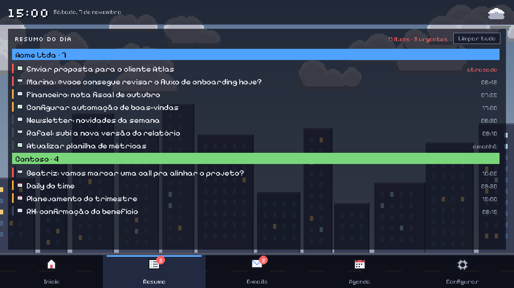 Aba Resumo do dia | 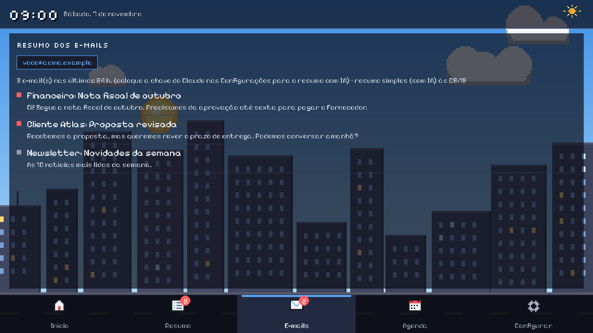 Aba E-mails (uma aba por conta) |
| 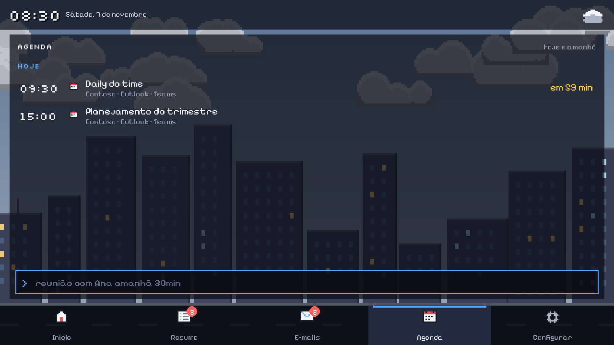 Aba Agenda com o agendador | 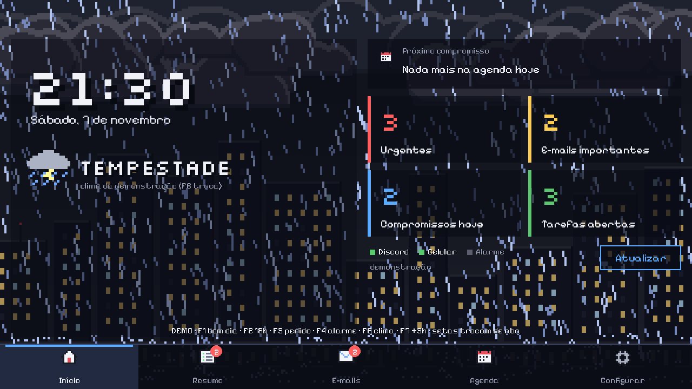 Tempestade à noite com relâmpagos |
| 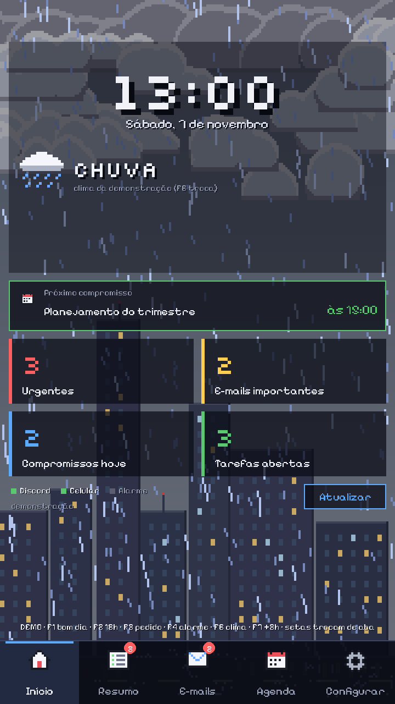 Layout vertical | 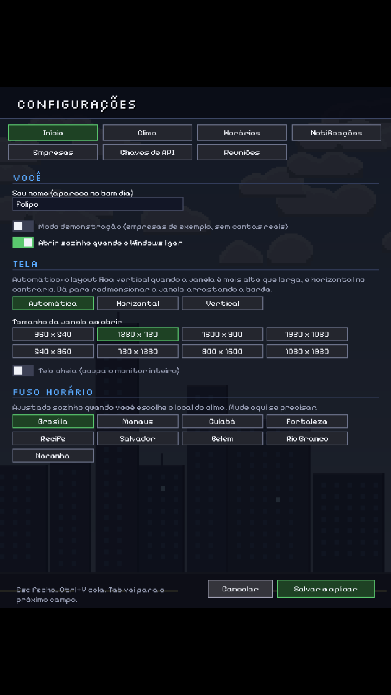 Configurações na vertical |
| 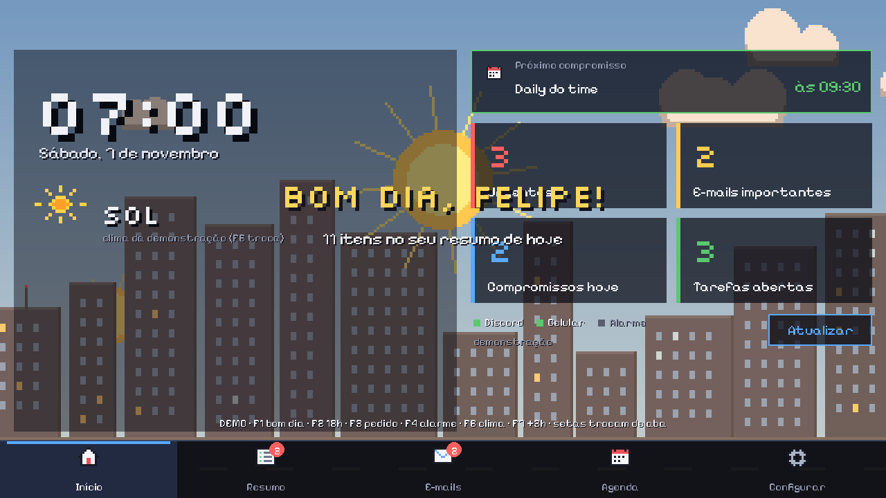 07:00 bom dia | 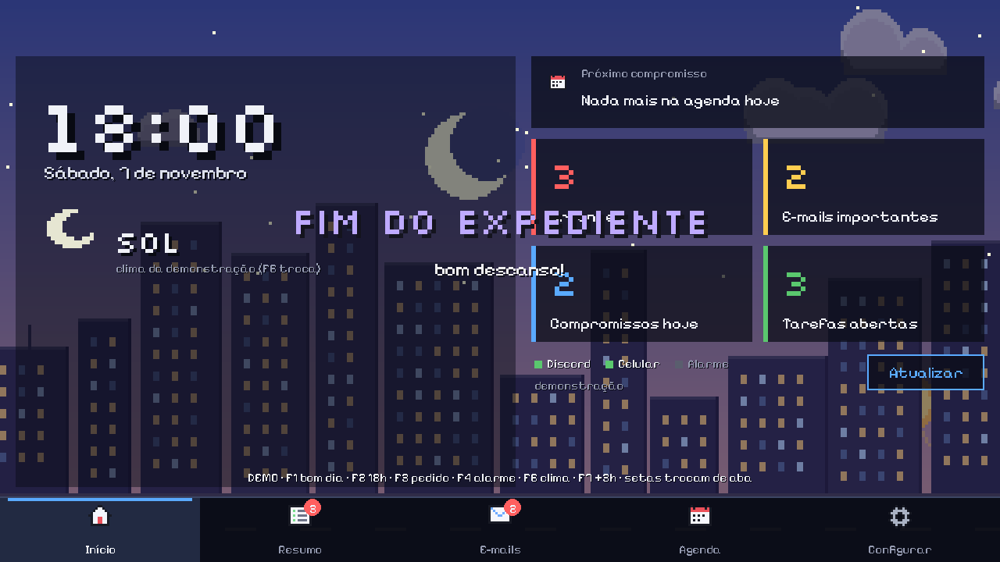 18:00 fim do expediente |
| 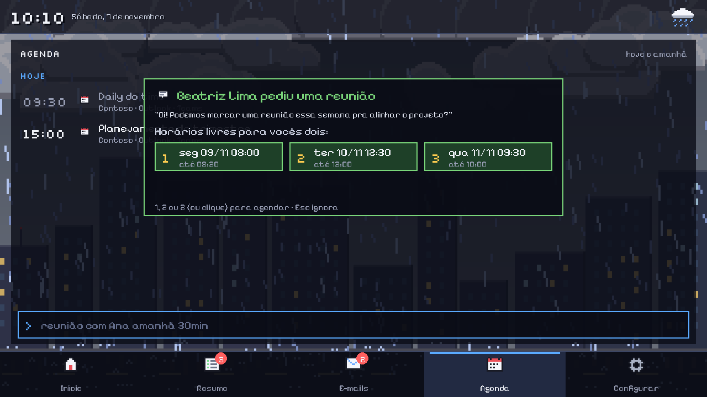 Pedido de reunião no Teams com horários livres | 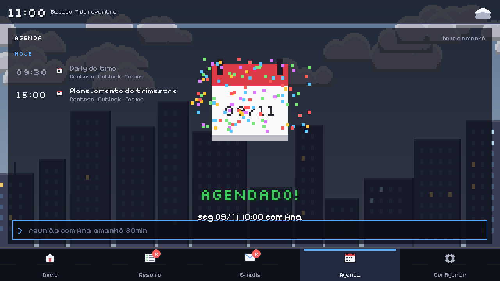 Reunião agendada |
| 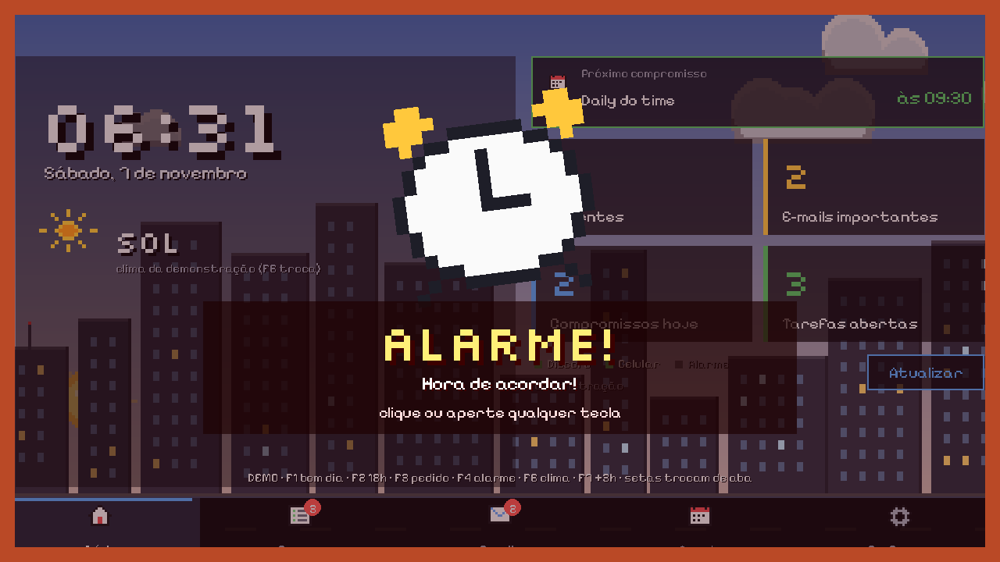 Alarme do celular | 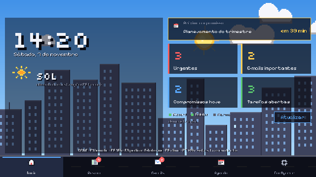 Clima mudando ao vivo |

Exemplo do JSON salvo em `data/digest-2026-11-06.json`:

```json
{
  "gerado_em": "2026-11-06T07:00:02",
  "clima": {"cidade": "São Paulo", "temperatura": 20.0, "descricao": "garoa fraca", "nuvens": 99, "intensidade_chuva": 0.2},
  "erros": [],
  "itens": [
    {"empresa": "Acme Ltda", "fonte": "clickup", "tipo": "tarefa", "titulo": "Enviar proposta", "detalhe": "ATRASADA", "prioridade": 3}
  ]
}
```

## 6. Melhorias futuras (roadmap)

1. **Resumo do dia inteiro escrito por IA**: hoje a IA resume só os e-mails; a ideia é transformar também o Slack, o ClickUp e a agenda num parágrafo único com as prioridades do dia.
2. **Agendador também no Google Agenda** (hoje só funciona com Outlook/Teams) e confirmação respondendo pelo próprio Discord.
3. **Painel web** com o histórico dos resumos (os JSON diários já estão salvos) e gráfico de quantas reuniões e tarefas por semana.

## Estrutura do código

```
pixeldigest/
  __main__.py        linha de comando (tela, demo, headless, login, testar)
  config.py          lê, valida e salva config.yaml + .env
  assistente.py      funções dos botões das Configurações (buscar endereço, conectar, testar)
  resumo_email.py    resumo dos e-mails com o Claude (JSON com schema e cache)
  net.py             HTTP com timeout, novas tentativas e erros claros
  models.py          Item, Clima, Horario, Digest (o formato comum)
  core.py            Motor: liga gatilhos a ações, em segundo plano
  scheduler.py       tarefas diárias (07:00, 18:00) e por intervalo
  digest.py          junta, ordena, formata e salva o resumo
  meetings.py        reconhece pedidos e interpreta "reunião com ..."
  notify.py          Discord + ntfy em paralelo, com fila de reenvio
  phone.py           escuta o alarme do celular (ntfy streaming)
  connectors/        slack, clickup, google, microsoft, zoom, weather, demo
  ui/                scene (cenário), effects (animações), app (abas e navegação), tela (orientação e escala), font,
                     settings (Configurações) e widgets (campos, botões, QR code)
tests/               38 testes com APIs simuladas
tools/               gerar_gif.py (GIF do README) e gerar_explicacao.py (explicação linha por linha)
docs/                guias, imagens e explicacao/ (o código explicado linha por linha)
```

## Explicação do código linha por linha

A pasta [docs/explicacao/](docs/explicacao/README.md) tem uma página para cada arquivo, com o código em trechos numerados e a explicação de cada linha logo abaixo. O índice sugere uma ordem de leitura, começando por onde o programa inicia (`__main__.py`) e terminando na interface e nos testes.

As páginas são geradas pelo `tools/gerar_explicacao.py` a partir das notas em `docs/explicacao/_notas/`. O código mostrado nas páginas é copiado direto dos arquivos, então nunca fica diferente do código real, e o script avisa se alguma linha de código ficou sem explicação.
